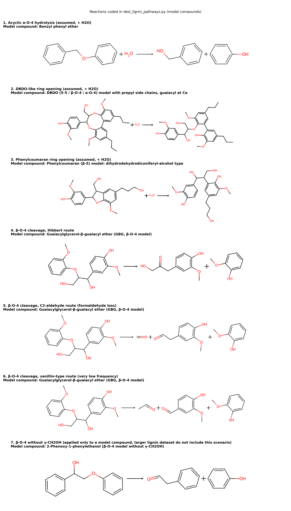

# DES Lignin Simulation Tool

This repository contains a rule-based model that simulates the conversion of lignin (for example, Milled Wood Lignin, MWL) into Deep Eutectic Solvent Lignin (DESL) fragments using RDKit. The model identifies β-O-4 and α-O-4 ether linkages by substructure matching, applies cleavage reactions to a user-set fraction of them, and reports molecular descriptors of the resulting fragments.

The main script is `utils/desl_lignin_pathways.py`. 

**Datasets:** the simulated DESL datasets are in [data_analysis/datasets/](https://github.com/sudhacheran/desl_simulation_tool/tree/main/data_analysis/datasets).

> **The model is a scenario tool, not a predictor.** The extent of each reaction is an input chosen by the user based on experimental observation. The ring-opening rules, vanillin-type route, and route ratios are assumptions from the literature (see [Assumptions and limitations](#assumptions-and-limitations)).

## Features

- **Substructure matching:** finds β-O-4 units and α-O-4 ethers (acyclic, DBDO-like rings and phenylcoumaran rings) in a SMILES input.
- **Rule-based cleavage:** optional hydrolysis of α-O-4 ethers, then β-O-4 cleavage with a seeded random choice between three product routes.
- **Mass-balance check** after every reaction event.
- **Molecular descriptors:** formula-based Mn, Mw and PDI, functional-group counts, and total OH content, with an optional molecular-weight cutoff that splits precipitated and soluble fractions.
- **Dataset generation:** retrieves the lignin structures from the LGS dataset and runs the model over them, writing one row per structure to a CSV.
- **Reaction schemes and workflow figures** drawn from the script's own reactions.

## Reactions, in the order they are applied

| Order | Reaction | Option | Default |
|---|---|---|---|
| 1 | Acyclic α-O-4 hydrolysis (+ H₂O) | `--acyclic-alpha-o4-cleavage-fraction` | 0 |
| 2 | DBDO-like ring opening (+ H₂O) | `--dbdo-cleavage-fraction` | 0 |
| 3 | Phenylcoumaran ring opening (+ H₂O) | `--alpha-o4-cleavage-fraction` | 0 |
| 4 | β-O-4 cleavage (how many units react) | `--cleavage-fraction` | 0.8 |
| 4a | → Hibbert ketone + phenol | `--p-hibbert` | 0.57 |
| 4b | → C₂-aldehyde + phenol + formaldehyde | `--p-c2-aldehyde` | 0.40 |
| 4c | → vanillin-type aldehyde + phenol + acetaldehyde (hypothesis) | `--p-vanillin` | 0.02 |
| 5 | β-O-4 without γ-CH₂OH (model compounds): aryl-acetaldehyde + phenol | uses `--cleavage-fraction` | 0.8 |

- The route weights in 4a to 4c are normalized to sum to 1.
- Each cleaved β-O-4 unit takes one route, chosen by a seeded random draw (`--random-seed`, default 10).
- Step 4 can only cleave a DBDO or phenylcoumaran unit after its ring has been opened (steps 2 and 3), because it needs a free Cα–OH.
- The legacy option `--vanillin-branch-fraction` (vanillin-type probability, Hibbert otherwise) cannot be combined with the `--p-*` options.

## Requirements

Python 3.x and the libraries in `requirements.txt` (RDKit, pandas, matplotlib, seaborn, scikit-learn, and Jupyter for the notebooks).

```bash
pip install -r requirements.txt
```

**Environment setup (recommended):** set up the environment with the provided script. It creates a virtual environment named `venv` and installs the dependencies.

```bash
bash setup.sh
```

Activate it again in a new terminal before running Python or Jupyter:

- macOS/Linux: `source venv/bin/activate`
- Windows (Command Prompt): `venv\Scripts\activate`
- Windows (PowerShell): `venv\Scripts\Activate.ps1`

## Running the script

From the repository root:

```bash
python utils/desl_lignin_pathways.py
```

Example with options:

```bash
python utils/desl_lignin_pathways.py \
  --smiles 'COc1cc(C(O)C(CO)Oc2ccccc2OC)ccc1O' \
  --cleavage-fraction 1.0 \
  --p-hibbert 0.57 --p-c2-aldehyde 0.40 --p-vanillin 0.02 \
  --min-precipitate-mw 50
```

Quote the SMILES in single quotes, because it contains `(`, `)` and `%`.

CLI parameters:

- `--smiles`: input structure in SMILES format (default: a long lignin model in the script).
- `--cleavage-fraction`: fraction of β-O-4 units to cleave, 0 to 1 (default 0.8). A single-unit molecule is cleaved only if the rounded count is at least 1, so use 0.5 or higher.
- `--p-hibbert`, `--p-c2-aldehyde`, `--p-vanillin`: route weights (defaults 0.57, 0.40, 0.02; normalized).
- `--vanillin-branch-fraction`: legacy option, see above.
- `--acyclic-alpha-o4-cleavage-fraction`, `--dbdo-cleavage-fraction`, `--alpha-o4-cleavage-fraction`: fractions for the optional hydrolyses (default 0).
- `--random-seed`: seed for the route draw (default 10).
- `--min-precipitate-mw`: optional cutoff in Da; fragments at or above it are reported as the precipitated fraction (default: none, not experimentally calibrated).
- `--reaction-time-hours`: printed only; it does not change the result.

### Notebooks

Start Jupyter from the activated environment and open one of:

- `desl-lignin-pathways.ipynb`: runs the pathway model on one structure.
- `data_analysis/desl_analysis.ipynb`: plots of a generated dataset.

```bash
jupyter notebook
```

### Generating a dataset

`data_analysis/generate_desl_dataset.py` runs the model on lignin structures from the LGS dataset and writes one row per structure. **The LGS structures are not included in this repository.** Obtain the LGS dataset from its source ([add the LGS dataset reference or link here]) and place its `.mol` files in `data_analysis/mol/<dp>/`, one folder per degree of polymerization (DP). The script then reads the folders from `--dp-min` to `--dp-max`:

```bash
python data_analysis/generate_desl_dataset.py --dp-min 18 --dp-max 25 \
  --cleavage-fraction 1.0 --alpha-o4-cleavage-fraction 1.0 \
  --acyclic-alpha-o4-cleavage-fraction 1.0 --dbdo-cleavage-fraction 1.0 \
  --out data_analysis/datasets/df_data_desl_pathways_100.csv
```

Its defaults are cleavage 0.8, 0.5 for the three optional hydrolyses and the route weights above. Repeated input structures are skipped unless `--keep-duplicates` is given. All files use the same random seed unless it is changed.

### Generated datasets

The datasets generated with the model are in [data_analysis/datasets/](data_analysis/datasets/). Each has one row per LGS structure (DP 15-25, 4,411 structures) with the simulated product mixture (`smiles`), formula-based masses and PDI, and functional-group counts. All use the default route weights (0.57 / 0.40 / 0.02) and random seed.

| File | β-O-4 cleavage | Acyclic α-O-4, DBDO and phenylcoumaran hydrolyses |
|---|---|---|
| [df_data_desl_pathways_dp15_25.csv](data_analysis/datasets/df_data_desl_pathways_dp15_25.csv) | 0.8 | 0.5 |
| [df_data_desl_pathways_dp15_25_cleave90_rings100.csv](data_analysis/datasets/df_data_desl_pathways_dp15_25_cleave90_rings100.csv) | 0.9 | 1.0 |
| [df_data_desl_pathways_dp15_25_100.csv](data_analysis/datasets/df_data_desl_pathways_dp15_25_100.csv) | 1.0 | 1.0 |
| [unique_products_dp15_25.csv](data_analysis/datasets/unique_products_dp15_25.csv) | the 1,213 unique products found in the first file (made with `data_analysis/extract_unique_products.py`) | |

The analysis notebook [data_analysis/desl_analysis.ipynb](data_analysis/desl_analysis.ipynb) reads these files and saves its figures in [data_analysis/charts/](data_analysis/charts/).


## Output includes

- The settings used and, for each step, how many sites were cleaved (for example `5/6`).
- Canonical SMILES, molecular weight, functional-group counts and PDI of the input.
- Number of fragments and each fragment SMILES.
- Total molecular weight of all fragments, functional-group counts, PDI, formula-based Mn and Mw, and total OH (mmol/g, not a ³¹P NMR prediction).
- With `--min-precipitate-mw`, the same for the precipitated and soluble fractions.

## Example output

This is the output of `python utils/desl_lignin_pathways.py` with the default structure and settings. The fragment SMILES that were very long are shortened here.

```text
DES Lignin : Simulation Model
=============================

DES solvent: choline chloride:lactic acid, 1:2 molar ratio
Temperature constraint: below 145 C
Assumed reaction time: 2 hours
Pathway random seed: 10
Modeled event: beta-O-4 cleavage with selected product pathways
Requested beta-O-4 cleavage fraction: 80%
Integer-rounded sites cleaved: 5/6 (83.3%)
Normalized beta-O-4 route weights (Hibbert / C2-aldehyde / vanillin): 0.58 / 0.40 / 0.02 (unverified scenario values)
Randomly assigned beta-O-4 products: 4 Hibbert-type, 1 C2-aldehyde, 0 vanillin-hypothesis
Actual route shares of cleaved sites: 80.0% Hibbert, 20.0% C2-aldehyde, 0.0% vanillin
C2-aldehyde route releases formaldehyde and is an assumed route distribution, not a measured one.
Phenylcoumaran and DBDO-like ring opening are assumptions based on literature.
Reaction time is metadata. Water is not a reactant in the beta-O-4 net-reaction template.
Condensation/repolymerization is not modeled.

INPUT
Molecular structure (SMILES) : 
COc1cc(C(O)C(CO)Oc2ccc(C(O)C(CO)Oc3ccc(C(O)C(CO)Oc4ccc(C(O)C(CO)Oc5ccc(C(O)C(CO)Oc6ccc(C7OCC8C(c9cc(OC)c%10c(c9)-c9cc(C%11OCC%12C(c%13cc(OC)c%14c(c%13)C(CO)C(c%13ccc(OC(CO)C(O)c%15ccc(O)c(OC)c%15)c(OC)c%13)O%14)OCC%11%12)cc(OC)c9OC(CO)C(c9cc(OC)c%11c(c9)C(CO)C(c9ccc(O)c(OC)c9)O%11)O%10)OCC78)cc6OC)cc5OC)cc4OC)cc3OC)cc2OC)ccc1O

Molecular weight (g/mol)          : 2424

Functional group                  : {'ether': 10, 'carbonyl': 0, 'methoxy': 13, 'phenolicOH': 3, 'aliphaticOH_secondary': 6, 'aliphaticOH_primary': 9, 'cinnamyl_alcohol': 0}

Poly dispersity index (PDI)       : 1.0

OUTPUT
Water molecules added by hydrolysis steps: 0 (+0.0 g/mol; input 2424.9 + water = 2424.9)
No precipitation cutoff set; all generated fragments are reported.

All simulated fragments

Number of fragments : 7
	C=O
	COc1cc(C(O)C(CO)Oc2ccc(C3Oc4c(OC)cc(C5OCC6C(c7cc(OC)c8c(c7)-c7cc(C9OCC%10C(c%11ccc(O)c(OC)c%11)OCC9%10)cc(OC) ... (shortened)
	COc1cc(CC(=O)CO)ccc1O
	COc1cc(CC(=O)CO)ccc1O
	COc1cc(CC(=O)CO)ccc1O
	COc1cc(CC(=O)CO)ccc1O
	COc1cc(CC=O)ccc1O

Total Molecular weight (g/mol) of all fragments: 2424

Functional group     		: {'ether': 5, 'carbonyl': 6, 'methoxy': 13, 'phenolicOH': 8, 'aliphaticOH_secondary': 1, 'aliphaticOH_primary': 8, 'cinnamyl_alcohol': 0}

Poly dispersity index (PDI) : 2.7

Mn / Mw (Da), formula-based : 346.41 / 935.68
Total OH (mmol/g, not a 31P NMR prediction) : 7.01
```

## Figures

Reactions coded in the script, each on a model compound:



## Assumptions and limitations

- The cleavage extents and route ratios are model inputs. They are not derived from time, temperature or DES composition.
- The α-O-4 and ring-opening hydrolyses, the vanillin-type route (its acetaldehyde balances atoms and is not an observed product) and the route ratios are unvalidated hypotheses.
- Not modeled: condensation or repolymerization, cleavage of β-β, β-5, 5-5 or 4-O-5 linkages, Cα oxidation, solvent effects, and solubility.
- Mn, Mw, PDI and OH content are calculated from molecular formulas and are not GPC or ³¹P NMR values. The total fragment mass equals the input mass plus one water (18.011 g/mol) per ring-opening event.


<hr/>
Feel free to fork this repository, submit issues, or send pull requests to improve the simulation and the overall functionality of the script.
